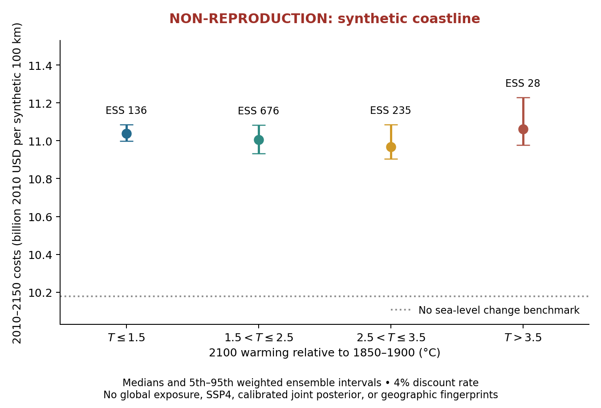

# Independent investigation of Wong et al. (2025), Figure 1

**Figure 1 is NOT REPRODUCED.** This repository contains an independently
implemented, tested climate–carbon–sea-level model and a working **synthetic
coastal benchmark**, with saved numerical results and an original figure.
It does not estimate global coastal costs and does not implement the full
calibrated SNEASY–BRICK–CIAM configuration used by Wong et al.

**Publication is blocked.** GitHub API access and authentication verification
failed; the supplied Git metadata is read-only. No public repository or
successful push is claimed. Local commits and a portable bundle preserve the
work; see [publication status](reports/publication_status.md).



The target paper is [Wong et al. (2025), *Coastal adaptation and damage costs
at different global warming thresholds*](https://doi.org/10.1038/s44304-025-00089-0).
Only written methodological publications and independent observations were
used. No original implementation, posterior samples, prepared input bundles,
processed simulations, original figure files, or previous reproduction project
were accessed. The supplied paper is excluded from version control.

## Results

4,096 independent parameter proposals drive the model from 1850 through 2150.
One proposal exceeds the published carbonate-formula domain and is explicitly
excluded, removing approximately 8.84e-10 of the pre-exclusion normalized weight.
Historical temperature and ocean-heat summaries weight the remaining 4,095
members. The total effective sample size is 1,068.6. This sensitivity measure
is **not the paper's joint posterior**, and the geography is hypothetical.

| 2100 warming, °C above 1850–1900 | Published global median, trillion USD2010 | Synthetic 100-km median [5th–95th], billion USD2010 | Effective samples |
|---|---:|---:|---:|
| ≤1.5 | 1.2 | 11.039 [10.998–11.085] | 135.8 |
| (1.5,2.5] | 1.5 | 11.005 [10.933–11.083] | 675.6 |
| (2.5,3.5] | 2.1 | 10.969 [10.904–11.086] | 234.9 |
| >3.5 | 2.6 | 11.061 [10.976–11.229] | 28.1 |

The benchmark is nearly flat across warming bins, unlike the published result.
Its warmest/coolest median ratio is 1.002, compared with 2.167 in the paper.
**Absolute and relative global-dollar errors are undefined:** the quantities
cover different geography, exposure, hazards, economics, and probability
measures. [The comparison CSV](results/published_comparison.csv) preserves those
missing comparisons rather than inventing them.

The no-rise counterfactual costs $10.179 billion. Initial protection against
existing surge hazards and residual flooding dominate the synthetic result.
Across the coolest and warmest bins, mean protection costs increase from
$4.53 to $5.63 billion while mean residual flood costs decrease from $5.84 to
$4.77 billion. Designs anticipate the maximum water level over each adaptation
window; larger early defenses suppress near-term flooding. These offsetting
accounts explain the flat conditional totals. They do not show that warming
has no economic consequence. Without adaptation, conditional median costs
increase from $53.13 to $58.32 billion. Discounting at 2% instead of 4% increases
the warmest-bin median by 72%; these are benchmark-specific sensitivities.

The reference physical run gives 1.239°C historical warming versus assessed
1.06°C, 0.542 YJ historical ocean heat gain versus 0.396 YJ, and 0.195 m
historical sea-level rise versus 0.200 m. Relative differences are +16.9%,
+37.0%, and −2.54%. Its 2025 CO2 holdout is 426.02 ppm versus 427.35 ppm.
These discrepancies and the conditioning periods are recorded in
[historical validation](results/historical_validation.csv).

## Rebuild

Required: a C++17 compiler, GNU Make, Python 3 with NumPy/SciPy/Matplotlib,
`pdflatex`, and `pdftotext`. The tested environment has GCC 8.5.0, Python 3.6.8,
NumPy 1.19.5, SciPy 1.5.4, Matplotlib 3.3.4, and TeX Live 2018. Exact Python
versions are recorded in [requirements.txt](requirements.txt). Existing
dependencies suffice; no system installation or network download is required.

From the repository root, one command recreates numerical outputs, figures,
the PDF, and the distribution audit:

```bash
make clean all audit
```

Use a single make job. All caches, fonts, binaries and TeX format files stay
under `build/`; the build does not need a writable home directory. A complete
run takes roughly 1–2 minutes on the supplied server. There is no Julia package
or external model dependency. Modern Python environments may use newer
compatible scientific packages instead of installing old pinned wheels.

Outputs:

* [Scientific report PDF](reports/report.pdf) and [LaTeX source](reports/report.tex).
* [Original Figure 1 alternative, PDF](figures/figure1_nonreproduction.pdf).
* [Ensemble proposals](results/ensemble.csv), [rejected member](results/rejected_members.csv),
  [conditional statistics](results/figure1_statistics.csv), and
  [Monte Carlo convergence](results/ensemble_convergence.csv).
* [Physical reference trajectory](results/reference.csv),
  [verification residuals](results/verification.csv), and
  [time/grid convergence](results/convergence.csv).
* [Figure/component status](reports/figure_status.csv),
  [scientific specification](reports/specification.md),
  [assumptions and parameter inventory](reports/assumptions.md), and
  [input provenance and licenses](data/README.md).

`make test` runs component verification; `make all` rebuilds out-of-date outputs.
`make audit` checks the explicit distribution set for common secret patterns,
private absolute paths, symlinks, excluded source PDFs and oversized files.
The optional `python3 scripts/retrieve_co2.py` verifies the committed NOAA
snapshot against the current upstream record; it requires working network
access and reports upstream revisions instead of silently changing inputs.

## Model and validation scope

The C++ implementation includes finite-volume DOECLIM heat diffusion, four
terrestrial carbon pools, carbonate chemistry and conservative ocean exchange,
glacier/Greenland relaxation, a DAIS Antarctic mass balance, bulk thermal
expansion, and an explicit land-water assumption. The ocean carbon geometry
is derived from published impulse-response modes with a small Python
preprocessing calculation. The coastal module analytically integrates surge
losses and compares inaction, retreat and protection over declared windows.
It is a separate original benchmark, **not a surrogate relabeled as CIAM**.

Checks cover equilibrium, conservation, the ocean impulse response, Antarctic
reference solutions, analytic versus numerical flood integration, accounting
identities, reference-period normalizations, timestep/grid refinement, ensemble
integrity, and finite-sample diagnostics. Half-year versus eighth-year steps
change reference 2100 warming by about 0.00001°C; 40 versus 160 ocean cells
change it by 0.0008°C and sea level by 0.0005 m. These small numerical errors
do not remove the scientific configuration errors. The warmest bin has only
about 1.4 effective samples in a nominal 5% tail, so its tail estimates remain
poorly resolved. Failed checks and corrections are preserved in
[verification notes](reports/verification_notes.md).

Exact reproduction still requires the unavailable supplement and joint
calibration, full historical/future forcing specification, rapid Antarctic
dynamics and their calibration, geographic fingerprints and land motion,
DIVA exposure, GTSR hazards, SSP4 trajectories, and exact economic accounting.
The source inventory identifies independent archives to pursue; it does not
claim those datasets are unavailable everywhere or unlicensable.

## Local checkpoints and publication recovery

In this restricted workspace, inspect commits with:

```bash
git --git-dir=build/checkpoints.git --work-tree=. log --oneline
```

The final checkpoint bundle is `build/sneasy-reproduction.bundle`. To restore
it into a new, writable checkout under this project:

```bash
git clone build/sneasy-reproduction.bundle build/publication-checkout
```

This is a transport workaround for read-only supplied Git metadata. In a normal
clone, use standard Git commands. Before publishing, verify the authenticated
identity, inspect any existing repository named `sneasy-reproduction`, and
preserve unrelated history. No credentials or copyrighted source PDFs belong
in the public repository.

Original project code and documentation use the [MIT license](LICENSE).
Third-party observations and cited literature retain their own terms.
